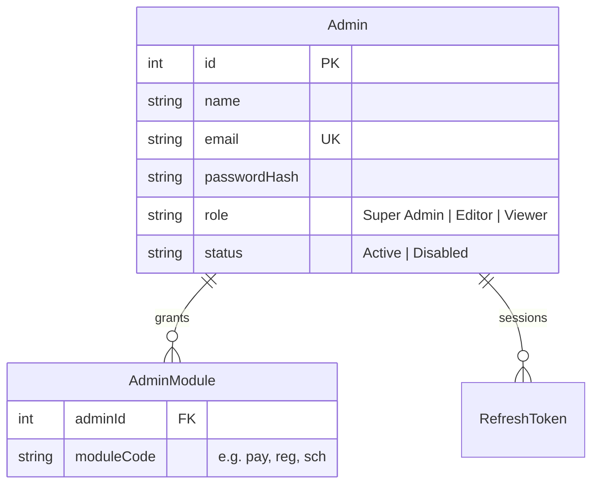

# Users Management (Admin Accounts) — Admin Operations & Technical Specification

**Module:** Admin → Admin Users (`ad`)
**Audience:** Admins operating the platform day-to-day, and engineers picking up this module.

> This document covers **admin/staff accounts** — the people who operate the CRM itself. It does not cover students or schools, which have their own documents.

---

## 1. What this module is for

Every person who can log into `/admin` is one `Admin` row: a name, email, password, a **role**, a **status**, and a set of **module grants** that decide exactly which sidebar sections they can see and use. This is the only screen where those are managed, and it is itself restricted to Super Admins.

---

## 2. Data model

**Role vs. Module — two separate, non-overlapping permission systems:**

| System | What it controls | Enforced where |
|---|---|---|
| **Role** (`Super Admin` / `Editor` / `Viewer`) | A hard-coded handful of Super-Admin-only actions (currently: managing Admin Users itself) | Backend (`SuperAdminGuard`) — a real, server-enforced check |
| **Module grants** (`AdminModule` rows) | Which sidebar sections/routes an admin can see and open (Competitions, Payments, Schools, etc.) | **Frontend only** — see §4 |

A `Super Admin` role always passes every module check automatically, regardless of what's actually granted in `AdminModule`. An `Editor`/`Viewer` sees only the sidebar sections whose module code is explicitly granted to them.

---

## 3. Passwords & sessions

- Passwords are hashed with **Argon2** (`@node-rs/argon2`), not bcrypt.
- Admin login issues a short-lived **15-minute access token** plus a **30-day refresh token**. The refresh token is stored server-side only as its SHA-256 hash (never the raw value), and each `/auth/refresh` call **rotates** it — the old refresh token is deleted and a brand-new pair issued. This means a stolen refresh token that's already been used once is worthless.
- `status: 'Disabled'` blocks login outright, with the exact same generic "Invalid email or password" error as a wrong password — deliberately, so a login attempt can't be used to discover which accounts exist or are disabled.
- The JWT itself carries `{sub, kind: 'admin', role}` — module grants are **not** baked into the token; they're re-fetched fresh from the database every time (`/auth/me`, login, refresh), specifically so that revoking a module grant takes effect immediately without waiting for the admin's token to expire.

---

## 4. ⚠️ Important: module permissions are enforced client-side only

This is worth understanding clearly rather than assuming it works like a typical role-based access system:

- The **sidebar** an admin sees is built by filtering the full navigation list through their granted module codes (`auth.hasModule(code)`).
- The **route guard** that redirects them to a "Forbidden" page if they navigate to an un-granted URL directly is **also client-side** (`moduleGuard`, an Angular route guard).
- **The NestJS API itself does not check module grants on any endpoint.** A logged-in admin's JWT authenticates them as *an admin* (via `JwtAuthGuard`/`RolesGuard`), and every admin API endpoint currently trusts that — it does not separately verify "does this specific admin have the `pay` module" before, say, returning payment records.

**Practical implication:** module grants are a genuine UX/navigation control — they keep an Editor's sidebar clean and prevent accidental clicks into areas they shouldn't touch — but they are **not** a hard security boundary at the API layer today. Any authenticated admin account (any role, any module grant) can currently call any admin API endpoint directly if they knew the URL. This matters for how much trust you place in a low-privilege Editor/Viewer account, and is worth a follow-up engineering task if stricter enforcement is needed.

---

## 5. Admin actions on this page

*(This page is itself only reachable by a Super Admin — both via a module grant and via the hard-coded `SuperAdminGuard` on the backend.)*

| Action | What it does |
|---|---|
| **Add Admin User** | Name, email, password (6+ characters), role, status, and a checklist of every module to grant. |
| **Edit** | Change any field. Leaving the password blank on an edit **keeps the existing password** — it is never accidentally cleared or reset by an empty field. |
| **Modules checklist** | A tick-box per sidebar section. This list is generated from the same navigation definition that builds the actual sidebar, so it can never drift out of sync with what modules really exist. |
| **Delete** | Hard-delete — also removes all of that admin's module grants and active sessions (cascading). |
| **Status filter** | Active / Disabled. |

**Role badge colors in the list:** Super Admin = gold, Editor = blue, Viewer = grey.

---

## 6. The complete module code list

| Code | Sidebar section |
|---|---|
| `dash` | Dashboard |
| `comp` | Competitions |
| `prize` | Prizes & Awards |
| `lb` | Leaderboard |
| `res` | Results *(also gates the Next-Stage Selection wizard)* |
| `reg` | Registrations |
| `pay` | Payment History |
| `sch` | Schools |
| `bcast` | Mass Email |
| `gr` | Classes & Grades |
| `q` | Question Bank |
| `qc` | Question Categories |
| `ex` | Exam Dates |
| `exb` | Exam Batches |
| `gri` | Grievances |
| `nt` | Notifications |
| `faq` | FAQs |
| `ann` | Announcements |
| `news` | News |
| `gal` | Gallery |
| `spon` | Sponsors |
| `plan` | Sponsorship Plans |
| `ad` | Admin Users *(Super Admin only, regardless of grant)* |
| `set` | Site Settings |
| `msg` | Message Templates |
| `certq` | Certificate Queue |

> **Note for engineers:** the Prisma schema's inline comment listing module codes is stale and missing several of the above (`bcast`, `gr`, `qc`, `exb`, `faq`, `set`, `msg`, `certq`). The actual source of truth is the navigation list in the admin shell component, not the schema comment — don't trust the schema comment when auditing what modules exist.

---

## 7. Key files (for engineers)

| Concern | File |
|---|---|
| Admin model, AdminModule join table | `api/prisma/schema.prisma` — `Admin`, `AdminModule` |
| Admin CRUD backend | `api/src/admin/admins/admins.controller.ts`, `admins.service.ts`, `admins.dto.ts` |
| Login / refresh / logout | `api/src/auth/auth.service.ts` — `adminLogin()`, `refresh()`, `logout()`, `safeAdmin()` |
| Role hierarchy check (Super Admin only) | `api/src/auth/guards/super-admin.guard.ts` |
| Account-kind check (admin vs student vs school) | `api/src/auth/guards/roles.guard.ts` |
| Admin CRUD frontend config | `web/src/app/features/admin/crud.config.ts` (`ad` entry) |
| Canonical module/route list | `web/src/app/features/admin/admin-shell.ts` — `NAV` |
| Frontend module enforcement | `web/src/app/core/guards/module.guard.ts` |
| Frontend role enforcement | `web/src/app/core/guards/role.guard.ts` |
