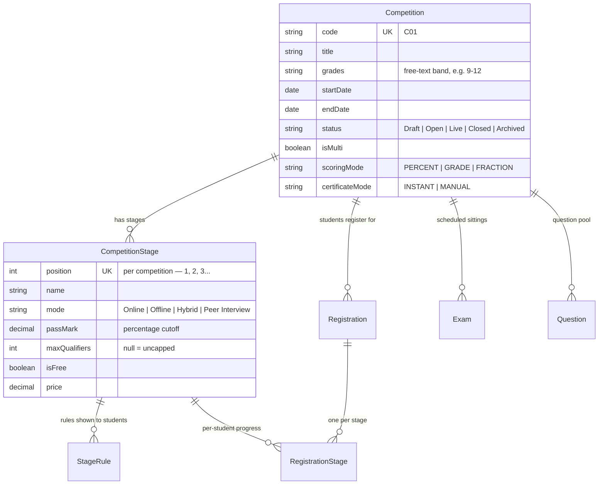
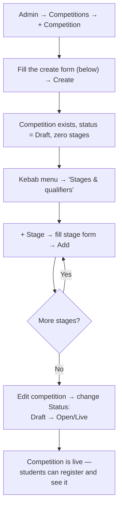

# Competitions Builder — Deep Technical Specification

**Module:** Admin → Competitions (`comp`)
**Audience:** Admins operating the platform day-to-day, and engineers picking up this module.

---

## 1. What this module is for

A **Competition** is the top-level container (e.g. "IML2026"). Under it sit one or more **Stages**, each with its own pass mark, price, and optional seat cap. Students register once for the whole competition and then progress stage by stage. This document covers building that structure; how students actually advance between stages is covered in the [Results & Selections](09-results-selections.md) document.

---

## 2. Data model

**`scoringMode`** only changes how a result is *displayed to the student* (a percentage, a letter grade, or a fraction) — admin views always show the raw score regardless.

**`certificateMode`**: `INSTANT` (the default) auto-queues a participation certificate the moment a student submits Stage 1; `MANUAL` requires an admin to issue each one individually from Results.

**`maxQualifiers`** is the single most consequential field on a stage: leave it blank and everyone who clears `passMark` advances immediately and automatically at submit time. Set a real number and advancement is deliberately **deferred** — the stage fills with `Attempted` students until an admin runs the Next-Stage Selection process (see the Results & Selections document).

---

## 3. The builder — this is a CRUD screen, not a step wizard

Worth knowing up front so you don't go looking for a stepper that doesn't exist: **Competitions are built as a list + detail page**, not a guided multi-step wizard. That said, in practice there is still a clear, fixed *sequence* an admin follows — this section documents that sequence exactly.

### Step 1 — Create the competition

Fields, in the order the form presents them:

1. **Title**
2. **Grades** (dropdown, sourced from Classes & Grades)
3. **Status** — Draft / Open / Live / Closed (starts Draft)
4. **Start date** / **End date**
5. **Multi-stage competition** checkbox
6. **Result scoring** — PERCENT / GRADE / FRACTION
7. **Certificate issuance** — INSTANT / MANUAL
8. **Description**
9. **Photo** (media-library picker)

Saving here creates the `Competition` row with **zero stages** — stages are always added afterward, from a separate screen.

### Step 2 — Add stages

From the list, the kebab menu's **"Stages & qualifiers"** action opens the competition's own detail view. On its Stages tab, **+ Stage** opens an inline form:

1. **Position** (auto-suggested as the next number after the highest existing stage)
2. **Pass mark %**
3. **Name**
4. **Mode** — Online / Offline / Hybrid / Peer Interview
5. **Free stage** checkbox
6. **Price** (only meaningful if not marked free)
7. **Max qualifiers for next stage** — blank = uncapped (with inline help text explaining what setting this actually does — defers advancement to the ranked-selection wizard)
8. **Description**

Repeat "+ Stage" for every stage the competition needs. **Adding a stage to a competition that already has registrants automatically backfills a `Locked` `RegistrationStage` row for every existing registration** — nobody who registered before the stage existed is left without one.

Stage **rules** (the bullet-point rules shown to students for a stage) exist as their own model (`StageRule`) but currently have **no editing form anywhere in this admin page** — they can only be removed, as a side effect of deleting the stage entirely. If stage rules need to be added or changed today, that requires a direct data change, not a UI action; worth flagging as a UI gap if this becomes a frequent need.

### Step 3 — Publish

There's no separate "publish" button. **Editing the competition and changing Status from `Draft` to `Open` or `Live`** is what makes it live. The only one-way transition exposed directly in the list's row menu is **Archive** — a soft-delete-style status change with no "unarchive" path back.

---

## 4. Backend endpoints

| Method & path | Purpose |
|---|---|
| `GET /competitions` | List (paginated, search/status filters — `Archived` excluded by default unless explicitly filtered) |
| `POST /competitions` | Create |
| `GET /competitions/:code` | Detail |
| `PATCH /competitions/:code` | Edit (including status changes) |
| `DELETE /competitions/:code` | Delete — cascades to stages, registrations, attempts, payments, rules |
| `GET /competitions/:code/stages` | List stages |
| `POST /competitions/:code/stages` | Add a stage — also backfills `RegistrationStage` rows for existing registrants |
| `PATCH /competitions/:code/stages/:stageId` | Edit a stage |
| `DELETE /competitions/:code/stages/:stageId` | Delete a stage — cascades to its registration-stage rows, attempts, payments, rules |
| `GET /competitions/:code/stages/:stageId/selection-preview` | Preview the ranked selection outcome (read-only) |
| `POST /competitions/:code/stages/:stageId/selection-commit` | Commit the selection — **deliberately takes no request body** (see Results & Selections) |
| `GET /competitions/:code/qualifiers` | Read-only list of every student's status at a given stage |
| `GET/POST/PATCH/DELETE /prizes` | Prize records (rank label, money, award name, note) tied to a competition |

---

## 5. How a Competition relates to an Exam

**`Exam` is a separate top-level model — it is not embedded inside `CompetitionStage`.** An `Exam` links only to a `Competition` (`Exam.competitionId`); there is no `stageId` field on it at all.

**In practice, today, an Exam always governs Stage 1** of its competition: whenever the student flow resolves "which exam am I taking," it looks up the competition's stages ordered by position and always takes the first one. There's currently no UI or backend path that binds an Exam to Stage 2 or later — multi-stage competitions handle their later stages through other mechanisms (e.g. offline/peer-interview modes, which don't need an `Exam` record at all).

The Question Bank pool is scoped the same way — a question's `competitionId` ties it to the whole competition, not to a specific stage.

*(Full detail on Exams and Batches is in the [Exams Management](04-exams-management.md) document.)*

---

## 6. Registration ↔ Competition ↔ Stage — how a student's journey actually starts

When a student registers for a competition (whether through public self-registration, an admin-created registration, or a bulk school upload — all three paths do this identically), the system:

1. Creates one `Registration` row linking the student to the competition.
2. Creates one `RegistrationStage` row for **every** `CompetitionStage` that competition currently has, in position order.
3. Only **Stage 1** opens immediately (`Unlocked`), and only if Stage 1 is free. Every other stage — including Stage 1 itself if it has a fee — starts `Locked`.

This is also why adding a new stage later automatically backfills a row for existing registrants (§3): the same underlying helper that sets this up initially is re-run whenever the stage list changes, so nobody's registration is ever missing a row for a stage that exists at the time they check.

*(What happens after this — the full status lifecycle, payment gating, and the cascading selection algorithm for capacity-limited stages — is the subject of the [Results & Selections](09-results-selections.md) document.)*

---

## 7. Key files (for engineers)

| Concern | File |
|---|---|
| Competition / CompetitionStage / StageRule models | `api/prisma/schema.prisma` |
| Admin builder UI (list + stage forms, not a wizard) | `web/src/app/features/admin/admin-competitions.page.ts` |
| Backend controller | `api/src/admin/competitions/competitions.controller.ts` |
| Backend service (create/stage/selection logic) | `api/src/admin/competitions/competitions.service.ts` |
| DTOs & validation | `api/src/admin/competitions/competitions.dto.ts` |
| Registration → RegistrationStage backfill helper | `api/src/common/util.ts` — `ensureRegistrationStages()` |
| Public registration entry point | `api/src/public/public.service.ts` — `register()` |
| Exam → Competition linkage (Stage-1 resolution) | `api/src/student/student.service.ts` — `resolveExam()` |
