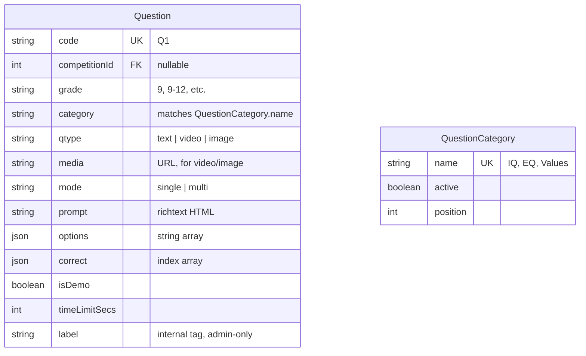
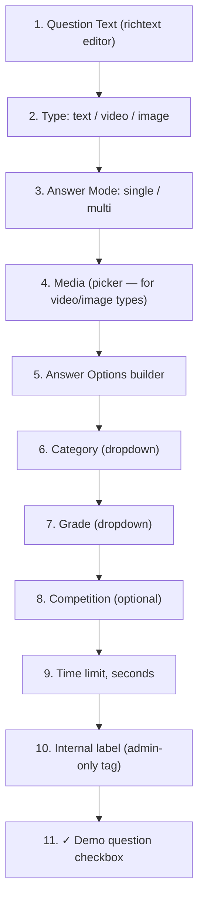

# Question Management — Admin Operations & Technical Specification

**Module:** Admin → Question Bank (`q`) + Question Categories (`qc`)
**Audience:** Admins operating the platform day-to-day, and engineers picking up this module.

---

## 1. What this module is for

Every question a student ever sees — in a real exam or the public Demo Exam — is one `Question` row here. This is where admins build and maintain that bank, tag questions by category/grade/competition, and control which few are reserved for the public demo.

---

## 2. Data model

`category` and `grade` are plain strings matched against `QuestionCategory.name`/`Grade.name` by value — not foreign keys. This mirrors how `Grade` itself works elsewhere in the system.

---

## 3. The `isDemo` flag — a hard, one-way wall

A question marked **Demo question** is pulled **exclusively** by the public Default Demo Exam. Every real-exam question draw explicitly filters `isDemo: false`, regardless of which competition it's scoped to — this is hardcoded in the student exam-loading path, not a filter that can be accidentally left off. **A demo question can never leak into a real, scored exam**, and a real exam question is never shown to an anonymous demo-taker.

Practical rule for admins building the bank: decide up front whether a question is for public demonstration or real scoring — don't plan to "reuse" a demo question in a real exam later by just flipping the checkbox, since anyone who saw it in the demo would already know the answer.

---

## 4. Building a question — the exact form, in order

**The Answer Options builder is the one non-obvious part of this form.** It renders each option as a row with its own text field:
- If **Answer Mode = single**: each row gets a **radio button** — picking one automatically un-picks any other, so exactly one correct answer is always enforced by the UI itself.
- If **Answer Mode = multi**: each row gets a **checkbox** — any number of options can be marked correct.

Blank rows are silently dropped on save. At least 2 options must remain — the "remove" button on a row disables itself once only 2 are left, so a question can never be saved with fewer than 2 answer choices.

---

## 5. Admin actions

| Action | What it does |
|---|---|
| **Add Question** | The full form described above. |
| **Edit** | Same form, pre-filled — including correctly reconstructing which option(s) were marked correct from the saved data. |
| **Bulk Upload** | CSV import — download the sample CSV first for the exact column headers. |
| **Filters**: Competition, Category, Grade, Demo (Demo only / Real only) | Narrow the list — the Demo filter is the fastest way to audit that only the intended handful of questions are demo-flagged. |
| **Question Categories** (separate page) | A simple, independent CRUD for the category list itself (name, sort order, active) — this is what populates the Category dropdown on every question form. Deactivating a category here doesn't delete it or touch existing questions already tagged with it — it just stops it from being offered for *new* tagging. |

---

## 6. Key files (for engineers)

| Concern | File |
|---|---|
| Question / QuestionCategory models | `api/prisma/schema.prisma` |
| Admin question CRUD + bulk upload | `api/src/admin/content/content.controller.ts`, `content.service.ts` (despite the module name, this is the Questions+Exams backend) |
| Question Categories CRUD | `api/src/admin/question-categories/` |
| Admin Question Bank form + options builder | `web/src/app/features/admin/crud.config.ts` (`q` entry) + `web/src/app/features/admin/admin-crud.page.ts` (options-builder logic, `zipOptions()`) |
| Real-exam isDemo:false enforcement | `api/src/student/student.service.ts` — `loadQuestions()` |
