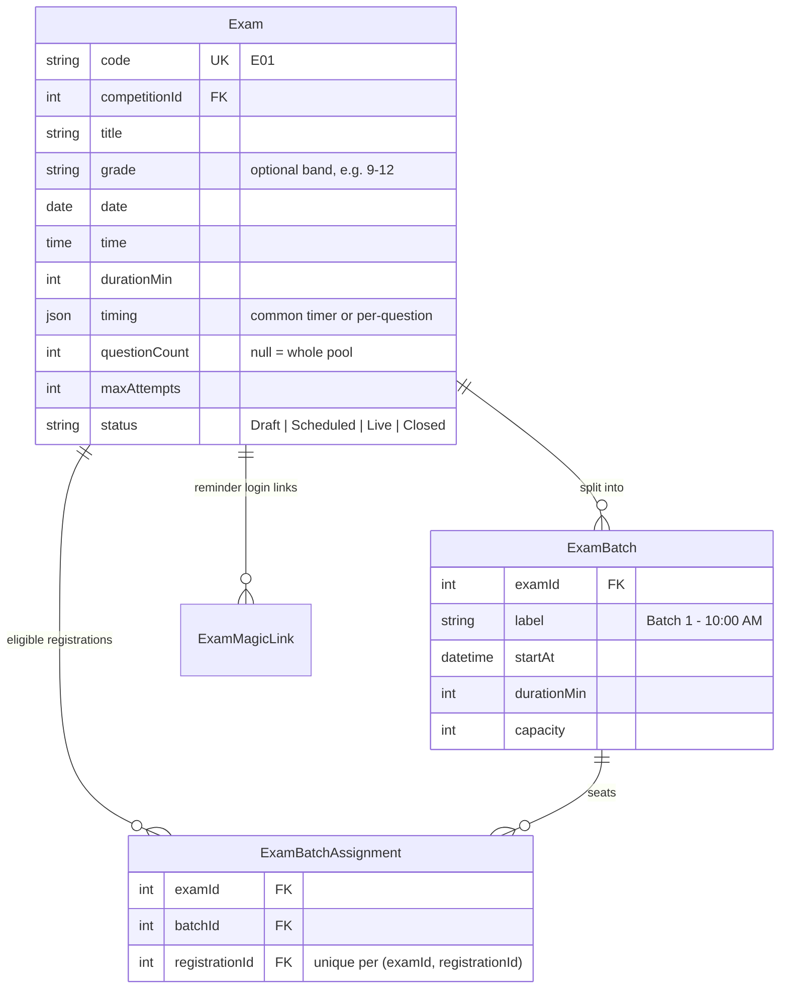
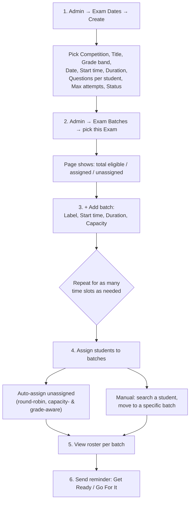

# Exams Management — Admin Operations & Technical Specification

**Module:** Admin → Exam Dates (`ex`) + Exam Batches (`exb`)
**Audience:** Admins operating the platform day-to-day, and engineers picking up this module.

---

## 1. What this module is for

An **Exam** is a scheduled sitting of a competition stage — a date, a time window, a question count, an attempt limit. For anything beyond a small sitting, that window gets split into **Batches** (capacity-capped time slots) so the entire registered population doesn't try to sit the test in the same instant. This is where both are set up, and where students get assigned to their specific slot.

---

## 2. Data model

**`questionCount = null`** means "serve the whole matching pool" — every eligible question, no random subset. Set an explicit number for a random draw of that size per attempt.

**`maxAttempts`** — a student can retake up to this many times. A prior *finished* attempt only gets cleaned up once the new attempt is actually submitted, never before, so there's no window where a retake in progress could wipe out the only completed record.

---

## 3. Setting up an exam — the full admin workflow

1. **Create the Exam Date** (`/admin/exams`) — a standard form: Competition, Title, Grade band, Date, Start time, Duration, Questions per student, Max attempts, Status.
2. **Open Exam Batches** (`/admin/exam-batches`), pick the Exam from the dropdown. The page immediately shows how many registrations are eligible, already assigned, and still unassigned.
3. **Add each batch** — a label (e.g. "Batch 1 - 10:00 AM"), its own start time, duration, and seat capacity. Capacity can never be edited down below however many students are already assigned to it — the system will refuse the change rather than silently orphan students.
4. **Assign students** — two ways, and you can mix both:
   - **Auto-assign** fills every batch you select, round-robin, up to its remaining capacity — using the exact same grade-eligibility check the student-facing exam start uses, so auto-assign can never seat someone who isn't actually eligible. Safe to run repeatedly; it only ever touches currently-*unassigned* students.
   - **Manual move** — search by name/email/phone (2+ characters), pick a result, choose the target batch. Useful for a specific correction (a student needs a different slot for a legitimate reason) without disturbing everyone else's auto-assignment.
5. **View the roster** for any batch — the full searchable, paginated list of who's assigned to it.
6. **Send a reminder** from the roster page — see §4.

---

## 4. Exam reminders and the "Go For It" magic link

Two reminder types, sent per-batch:

| Type | When to use it | What it contains |
|---|---|---|
| **Get Ready** | Before the batch window opens | "Your test starts at {time}, log in 5 minutes early." A plain heads-up — no login link. |
| **Go For It** | The moment the batch window actually opens | "The window is open — take your test now," **with a direct one-click login link.** |

The **Go For It** link is a genuine magic link: the system mints a random, single-use-tracked token (`ExamMagicLink`) per student, valid until that batch's window closes. Clicking it logs the student straight in — no OTP, no password — and drops them directly onto their exam. This exists specifically to remove every possible point of friction between "the window just opened" and "the student is actually answering questions," since every extra login step is lost exam time for them.

Each reminder send is fire-and-forget per recipient, so one student's bounced email/SMS never blocks the rest of the batch from receiving theirs.

---

## 5. How the exam actually runs for a student (brief, for context)

- **Eligibility gate**: before showing exam details, starting, saving, or submitting, the system checks the exam isn't Closed, the student's grade matches, they're registered, and — if the exam has batches — that they have a batch assignment and the current time is inside *that batch's* window (not just the exam's overall window).
- **Starting**: if the student already has an unfinished attempt, they **resume it exactly where they left off** — same frozen question set and order, same autosaved answers — rather than getting a fresh reshuffled attempt. This is deliberate: it's both the anti-refresh-abuse mechanism and the disconnect-recovery mechanism at once.
- **Autosave**: answers are saved incrementally as the student works, which is what makes the resume above possible.
- **Submitting**: grading always uses the exact question set frozen onto that attempt at start time — never a fresh pool query — so a student is always scored against the same questions they were actually shown, never a different random draw.

*(Full technical detail on grading, qualification, and stage progression lives in the Results & Selections document.)*

---

## 6. Certificates and live exams

Certificates (participation certificates, issued on Stage-1 submission) deliberately **stop generating entirely while any exam window is live**, anywhere in the system — even ones marked `Live` in status get their actual time window double-checked, since nothing automatically flips an exam's status back once its window closes. See the Certificates document for detail; the only thing to know here is that certificate delays right after a batch runs are expected, not a bug, until every currently-open exam window has actually closed.

---

## 7. Key files (for engineers)

| Concern | File |
|---|---|
| Exam / ExamBatch / ExamBatchAssignment / ExamMagicLink models | `api/prisma/schema.prisma` |
| Exam CRUD, batch CRUD, assignment, reminders | `api/src/admin/content/content.service.ts` (despite the module name, this is the Questions+Exams backend), `content.controller.ts` |
| Admin Exam Dates form | `web/src/app/features/admin/crud.config.ts` (`ex` entry) |
| Admin Exam Batches page (custom, not generic CRUD) | `web/src/app/features/admin/admin-exam-batches.page.ts` |
| Batch roster + reminder sending | `web/src/app/features/admin/admin-exam-batch-roster.page.ts` |
| Magic link consumption | `api/src/auth/auth.service.ts` — `consumeExamLink()` |
| Student exam lifecycle | `api/src/student/student.service.ts` — `resolveExam()`, `startExam()`, `saveProgress()`, `submitExam()` |
| Certificate/exam interaction | `api/src/certificates/certificate-queue.service.ts` — `isAnyExamRunning()` |
