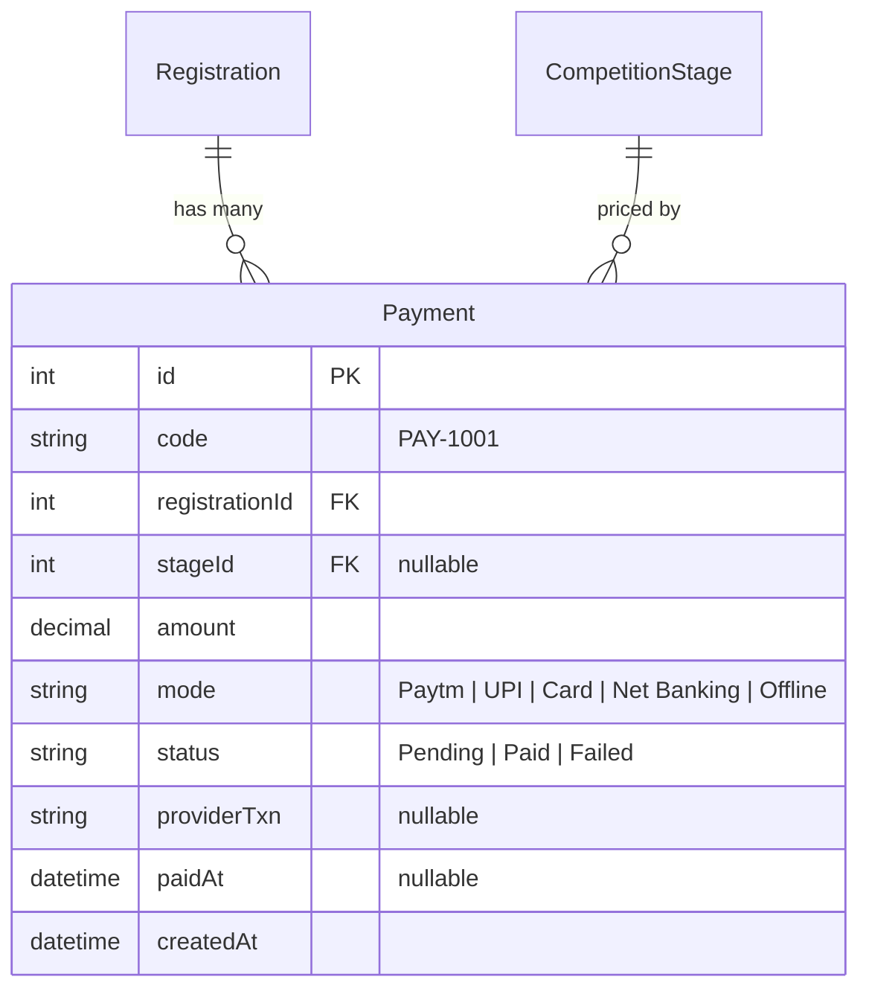
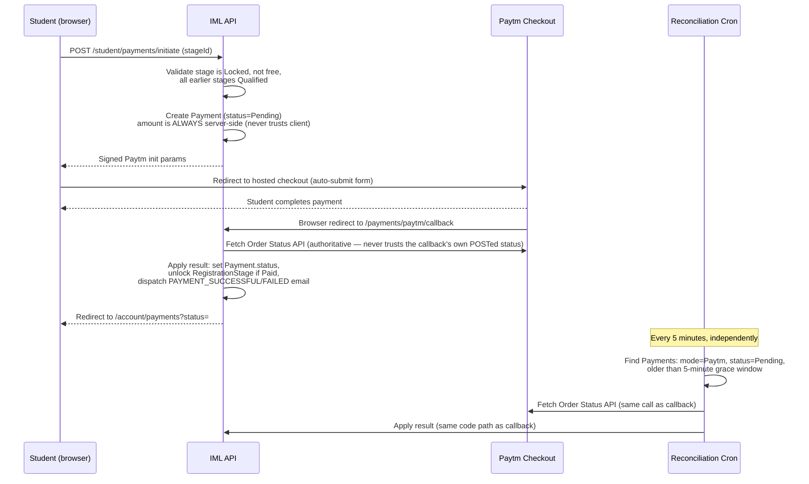

# Payments — Admin Operations & Technical Specification

**Module:** Admin → Payment History (`pay`)
**Audience:** Admins operating the platform day-to-day, and engineers picking up this module.

---

## 1. What this module is for

Every rupee a student pays — for their first-stage registration fee or a later stage's unlock fee — creates exactly one `Payment` row. This page is the single source of truth for "who paid, how much, by what method, and when." It also doubles as the admin's manual override tool for cash/offline payments and for correcting a stuck record.

---

## 2. Data model

- **`mode`** distinguishes *how* the money moved. Only `Paytm` is ever created by the system itself (via the student checkout flow below). `UPI` / `Card` / `Net Banking` / `Offline` are the options an admin picks when manually recording a payment collected outside the app (e.g. cash at school, a bank transfer).
- **`status`** starts `Pending` and is later set to `Paid` or `Failed` — never any other value.
- A registration can have **more than one** `Payment` row over its lifetime (one per stage that has a fee), but never two *successful* payments for the same stage.

---

## 3. The real payment flow (Paytm) — end to end

This is the flow that actually charges a student's card/UPI/wallet. Understanding it end-to-end matters because two independent mechanisms keep it correct even when Paytm's own redirect is unreliable.

**Why two mechanisms exist:** Paytm's classic checkout redirect is a *browser* redirect, not a guaranteed server-to-server webhook. If the student closes the tab, loses connectivity, or the redirect otherwise never lands, the callback never fires and the payment would sit `Pending` forever. The 5-minute reconciliation cron (`PaymentReconcileService`) is the backstop — it independently re-checks Paytm's own Order Status API for anything still `Pending` past a 5-minute grace period (so it never races a payment that's still legitimately in progress). **Both paths call the exact same `applyResult()` logic**, so they can never disagree with each other.

This was added after a real incident: 7 payments were once stuck `Pending` because the callback redirect silently failed, requiring a manual fix. The cron exists specifically so that never has to happen by hand again.

**The amount is never trusted from the client** — it's always read server-side from the `CompetitionStage.price` the student is actually eligible to pay for. A student cannot manipulate the amount by tampering with the checkout request.

**What "unlocking a stage" means:** each `RegistrationStage` starts `Locked`. A successful payment for that stage's fee is what flips it to payable/active — see the Results & Selections document for the full stage-status lifecycle.

---

## 4. What the student sees, and its one known limitation

The student's own Payment History page (`/account/payments`) fetches their payments and any currently-due stage **once** on page load, plus reads the `?status=` query param Paytm's callback redirect carries back to show a success/error banner. It **polls every 15 seconds for up to ~2 minutes** whenever it sees a `Pending` payment, so a stage that unlocks moments after the redirect (or via the cron catching up) will update on screen without the student needing to manually refresh — this polling was added specifically to close the gap between "redirect landed but reconciliation hasn't run yet" and "student is staring at a stale Pending badge."

If a payment is *still* `Pending` after that ~2-minute polling window closes, the student would need to reload manually to see it — but the 5-minute cron will have resolved it by then regardless, they just won't see the flip live on that particular page load.

---

## 5. Admin actions on this page

| Action | What it does | When to use it |
|---|---|---|
| **Record payment** | Creates a brand-new `Payment` row directly, with an admin-chosen `mode` (UPI / Card / Net Banking / Offline) and `status`. | A school paid a student's fee offline (cash, bank transfer, cheque) and you need it reflected in the system. **Never used for Paytm** — those are always system-created. |
| **Edit** | Lets you change `amount`, `mode`, `status`, or `providerTxn` on an existing row — including flipping a stuck `Pending` to `Paid` by hand. | A genuine edge case slipped past both the callback and the cron (rare — check the cron logs first), or correcting a data-entry mistake on an offline record. |
| **Filter by Competition / Status** | Narrows the list. | Auditing, or answering "has this school paid for stage 2 yet?" |
| ~~Delete~~ | **Not available.** Payments are a financial record — there is no delete action on this module by design. | — |

**Columns shown:** Code, Student, **School** (the student's linked school name, or `—` if the student has no school on file — this is expected, not a bug, for self-registered students without a school link), Stage, Amount, Mode, Status (color-coded badge), Paid date.

---

## 6. Troubleshooting

| Symptom | Likely cause | What to check |
|---|---|---|
| A student says they paid but their stage is still locked | Callback didn't land; cron hasn't run yet (up to 5 min lag) | Search the student's registration in Payment History — if `Pending`, wait for the cron or manually re-check via Paytm's own merchant dashboard before editing anything |
| Payment shows `Failed` but the student insists they were charged | Paytm-side decline/timeout that still moved money (rare gateway edge case) | Cross-check the `providerTxn` against Paytm's merchant dashboard directly — this is a Paytm-side reconciliation, not an app bug |
| A `Pending` Paytm payment sits for hours | Reconciliation cron itself may be down, or Paytm's Order Status API is erroring | Check API server logs for `PaymentReconcileService` errors around the payment's `createdAt` |
| Amount looks wrong | Amount is always the stage's price at initiation time — if the stage's price changed *after* this payment was created, this row still reflects what was actually charged | This is correct behavior, not a bug — `CompetitionStage.price` changes are not retroactive |

---

## 7. Key files (for engineers)

| Concern | File |
|---|---|
| Payment initiation | `api/src/student/student.service.ts` — `initiatePayment()` |
| Paytm signing/order-status client | `api/src/payments/paytm.service.ts` |
| Reconciliation cron | `api/src/payments/payment-reconcile.service.ts` |
| Callback endpoint | `api/src/public/public.controller.ts` (`POST /payments/paytm/callback`) → `api/src/public/public.service.ts` `paytmCallback()` |
| Admin CRUD | `api/src/admin/registrations/...` (Payment model shares the registrations admin module) + `web/src/app/features/admin/crud.config.ts` (`pay` entry) |
| Student payments page + polling | `web/src/app/features/account/payments/account-payments.page.ts` |
