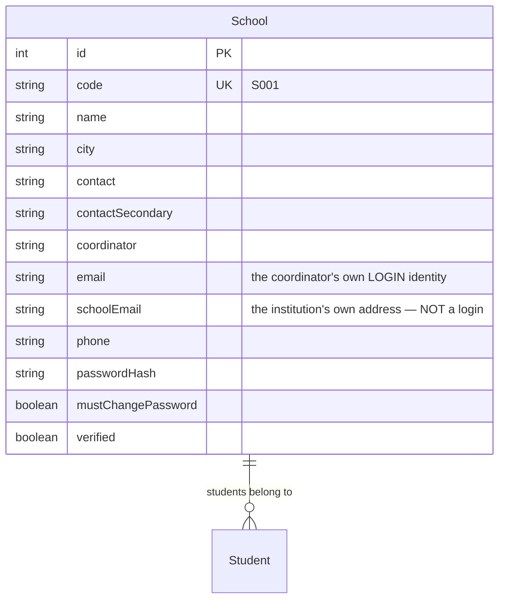
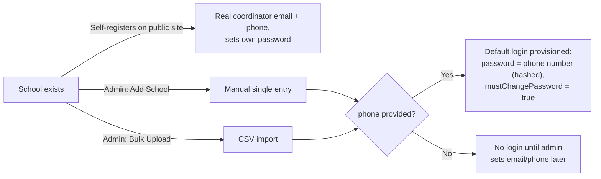
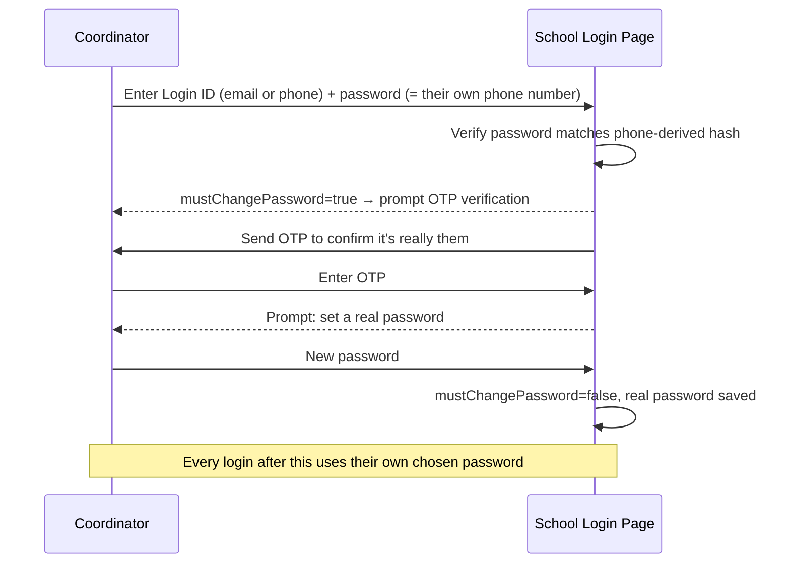

# Schools — Admin Operations & Technical Specification

**Module:** Admin → Schools (`sch`)
**Audience:** Admins operating the platform day-to-day, and engineers picking up this module.

---

## 1. What this module is for

Every school in the system — whether it self-registered through the public site or was added directly by IML — is one `School` row here. This is also where an admin sets up a school's ability to log into its own portal, and where the two *different* email addresses a school can have are managed.

---

## 2. Data model

**The two emails are not interchangeable — this is the single most important thing to understand about this model:**

| Field | What it actually is | Used for |
|---|---|---|
| `email` | The **named coordinator's personal login identity** (e.g. `priya.verma@school.edu`) | School portal sign-in; the "All Coordinators" mass-email audience; carries `{LoginId}`/`{LoginPassword}` merge fields |
| `schoolEmail` | The **institution's own address** (front office, `info@school.edu`) — has no login meaning at all | The "All Schools" mass-email audience; general institutional contact |

A school can have one, both, or neither set. A school with only `schoolEmail` set cannot log in (no login identity) but can still receive institutional mail. A school with only `email` set can log in but won't appear in an "All Schools" send.

---

## 3. How a school gets into the system

- **Bulk Upload** (Admin → Schools → Bulk Upload) takes a CSV with columns `name, city, contact, contactSecondary, coordinator, schoolEmail, email, phone` — download the sample CSV from the same screen to get the exact header row. It only ever **creates** new rows; it does not update existing schools by code or name (uploading the same school twice creates a duplicate — see §5).
- Any school created with a `phone` on file gets a **default login** automatically: their login password is their own phone number (argon2-hashed), and `mustChangePassword` is set so they're forced to pick a real password on first sign-in. This is what the public login page's "First time signing in?" panel explains to coordinators.

---

## 4. School login & first-time activation

This is the exact flow described to schools on the public `/schools/login` page's "First time signing in?" panel: **Login ID = registered email or phone, default password = registered phone number.** The OTP step exists so that setting a real password can't be done by anyone who merely guessed a phone number.

---

## 5. Duplicate schools — a real, recurring data-quality issue

Because schools can be created three different ways (self-register, admin single-add, bulk upload) with no automated identity matching between them, the same physical school can end up as **two or more separate rows** — most often chain schools with multiple branches, where one coordinator registers under a generic name ("DAV Public School") and another registers the same branch under a more specific one, or a bulk upload creates a fresh row instead of updating an existing match.

**How to detect duplicates:**
1. Exact name collisions — trivial, query `GROUP BY name HAVING COUNT(*) > 1`.
2. Fuzzy name similarity + matching email/phone/city — genuine duplicates almost always share *either* an exact email or an exact phone, even when the name has minor spelling/spacing differences.

**How to merge two duplicate School rows safely** (this has been done manually in production — there is no admin UI button for it yet):
1. Confirm they really are the same physical school (matching phone or email, not just a similar name — two different schools can coincidentally share a name).
2. Pick the record to keep (prefer the one with real student registrations, or the more complete contact info).
3. Re-point every `Student.schoolId` from the losing record to the keeper's `id`.
4. Delete the now-empty losing `School` row.

Only `students.school_id` and `broadcast_recipients.school_id` reference a School — check both before deleting.

---

## 6. Admin actions on this page

| Action | What it does |
|---|---|
| **Add School** | Manual single-entry form — name, city, contact numbers, coordinator name, both emails, phone. |
| **Bulk Upload** | CSV import, create-only (see §3). Download the sample CSV first to get the exact column headers. |
| **Edit** | Change any field, including setting/correcting `schoolEmail` for mass-email purposes. |
| **Delete** | Hard-delete — only safe once you've confirmed no students reference this school (or you're mid-merge, per §5). |

---

## 7. Key files (for engineers)

| Concern | File |
|---|---|
| School model | `api/prisma/schema.prisma` — `School` |
| Create / bulk upload / default password provisioning | `api/src/admin/registrations/registrations.service.ts` — `createSchool()`, `bulkUploadSchools()`, `schoolDefaultPasswordFields()` |
| School login / first-time activation flow | `api/src/auth/auth.service.ts` — `schoolLogin()`, `completeSchoolFirstLogin()` |
| Admin CRUD config | `web/src/app/features/admin/crud.config.ts` — `sch` entry |
| Public school login page + first-time panel | `web/src/app/features/school/school-login.page.ts` |
