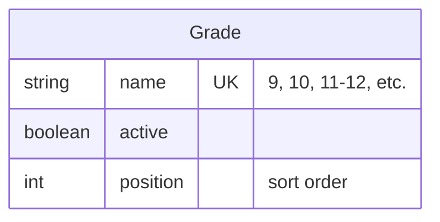

# Classes & Grades — Admin Operations & Technical Specification

**Module:** Admin → Classes & Grades (`gr`)
**Audience:** Admins operating the platform day-to-day, and engineers picking up this module.

---

## 1. What this module is for

The list of valid grade/class values used everywhere in the app — the Grade dropdown on student registration, the Question Bank's grade filter, an Exam's grade band — all come from this one small, admin-managed list. It is deliberately simple: this is a reference/lookup table, not a complex entity with its own business logic.

---

## 2. Data model

`Grade.name` is the value actually stored wherever a "grade" is recorded elsewhere in the system (`Student.grade`, `Question.grade`, `Exam.grade`) — it's a plain string match, not a foreign key relationship. This means a grade value like `"9-12"` is just as valid a "grade" as a single `"9"` — the field is free text validated only by what this admin list currently offers as options.

---

## 3. Admin actions

| Action | What it does |
|---|---|
| **Add grade** | Name (e.g. `9`, `10`, `9-12`), sort order, active checkbox. |
| **Edit** | Change the name, reorder it, or toggle active/inactive. |
| **Delete** | Removes it from the list of options going forward. |
| **Active toggle** | Deactivating a grade removes it from *new* selections everywhere it's offered as a dropdown option — it does **not** retroactively change any student/question/exam that already has that grade value recorded. |

**Sort order (`position`)** controls the order grades appear in every dropdown across the app — set it once here and it's consistent everywhere, rather than each dropdown sorting independently.

---

## 4. A practical note on renaming

Because `Grade.name` is matched by plain string value rather than a stable ID reference, **renaming an existing grade does not retroactively update records that already stored the old name.** If you rename `"9-12"` to `"9-12 (Senior)"`, every student/question/exam already tagged with the literal string `"9-12"` keeps that old value — they won't automatically show the new name, and they won't match a grade filter searching for the new name either. If a genuine rename is needed, plan for a one-off data migration to update existing records to match, rather than expecting the rename alone to propagate.

---

## 5. Key files (for engineers)

| Concern | File |
|---|---|
| Grade model | `api/prisma/schema.prisma` — `Grade` |
| Admin CRUD backend | `api/src/admin/grades/grades.controller.ts`, `grades.service.ts`, `grades.dto.ts` |
| Admin CRUD frontend config | `web/src/app/features/admin/crud.config.ts` (`gr` entry) |
