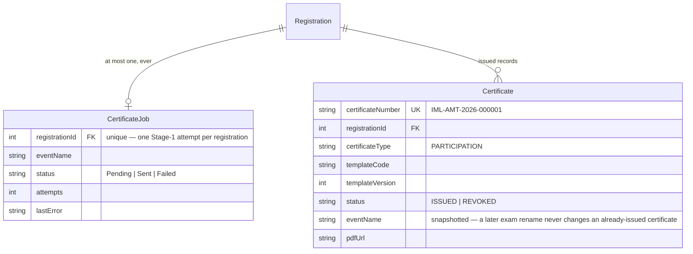
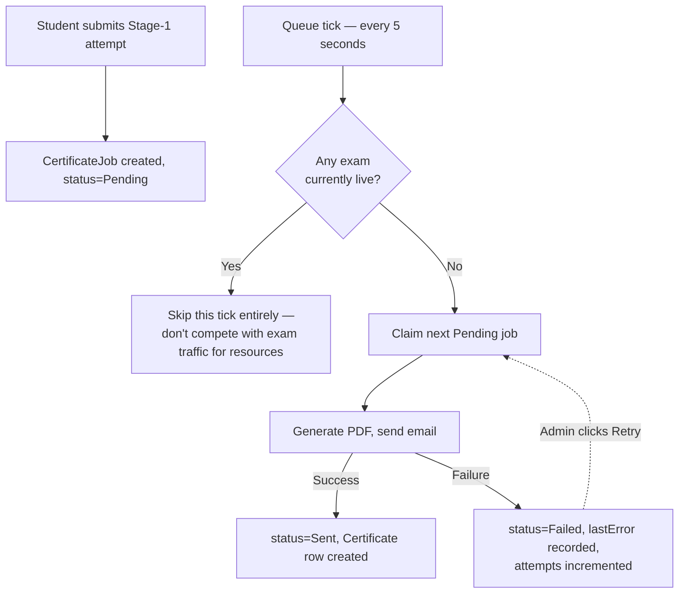

# Certificates — Admin Operations & Technical Specification

**Module:** Admin → Certificate Queue (`certq`)
**Audience:** Admins operating the platform day-to-day, and engineers picking up this module.

---

## 1. What this module is for

Every student who submits their Stage-1 attempt automatically earns a **Participation Certificate** — this is generated and emailed to them without any admin action. This admin page exists purely to **monitor and retry** that background process when something goes wrong (an email bounce, a PDF-generation hiccup), not to manually create certificates one at a time.

---

## 2. Data model

- **`CertificateJob`** is the *queue entry* — one gets created the moment a student submits their Stage-1 exam attempt. Its `registrationId` is unique, so a registration can only ever have one job, ever (no duplicate certificates from re-submission edge cases).
- **`Certificate`** is the *finished, issued record* — created once the job successfully generates a PDF and sends the email. `eventName` is deliberately **snapshotted** at issuance time: if the competition/exam is later renamed, every certificate already issued still shows the name it was actually earned under.

---

## 3. How the queue actually runs

**The one rule that matters most operationally: certificates never generate while any exam window is live.** The queue checks `isAnyExamRunning()` on every 5-second tick — if a student is anywhere mid-exam, the entire queue pauses (even mid-drain, it re-checks and breaks out if a new exam window opens) and resumes automatically the moment no exam is running. This is deliberate resource prioritization: PDF generation and email dispatch never get to compete with live exam traffic for server resources.

**This also explains a common non-bug:** if a batch of exams just started, don't be alarmed that certificates aren't generating — that's correct behavior, not a stuck queue. Check whether an exam window is currently open before assuming something's broken.

---

## 4. Admin actions on this page

| Action | What it does |
|---|---|
| **View the queue** | Every job with its current status, attempt count, and (for failures) the exact last error message — hover over a truncated error to see the full text. |
| **Retry** | Re-queues a `Failed` job as `Pending` so the next tick picks it up again. Use this after fixing whatever caused the failure (e.g. a transient email provider outage) — retrying without understanding the error will usually just fail the same way again. |

There is **no manual "issue a certificate" action** on this page by design — every certificate is earned by actually submitting an attempt, not granted by an admin.

---

## 5. Troubleshooting

| Symptom | Likely cause |
|---|---|
| A student says they submitted their exam hours ago and never got a certificate email | Check the queue for their registration — if `Pending` and staying that way, an exam window is probably still open somewhere (§3); if `Failed`, read `lastError` |
| Many jobs `Failed` around the same time with the same error | Likely a shared external dependency issue (email provider outage, PDF-rendering service down) rather than N separate individual problems — fix the root cause, then Retry all of them |
| A certificate shows the wrong event name | It shouldn't — `eventName` is snapshotted at issuance and never updates from a later rename. If it's genuinely wrong, the mistake was already present at the moment of issuance (e.g. the exam was misnamed *before* this student attempted it) |

---

## 6. Key files (for engineers)

| Concern | File |
|---|---|
| Certificate / CertificateJob models | `api/prisma/schema.prisma` — `Certificate`, `CertificateJob` |
| Queue processor (5-second tick, exam-aware gating) | `api/src/certificates/certificate-queue.service.ts` |
| Job creation on exam submit | `api/src/student/student.service.ts` — `submitExam()` |
| Admin queue view + retry | `web/src/app/features/admin/admin-certificate-queue.page.ts` |
