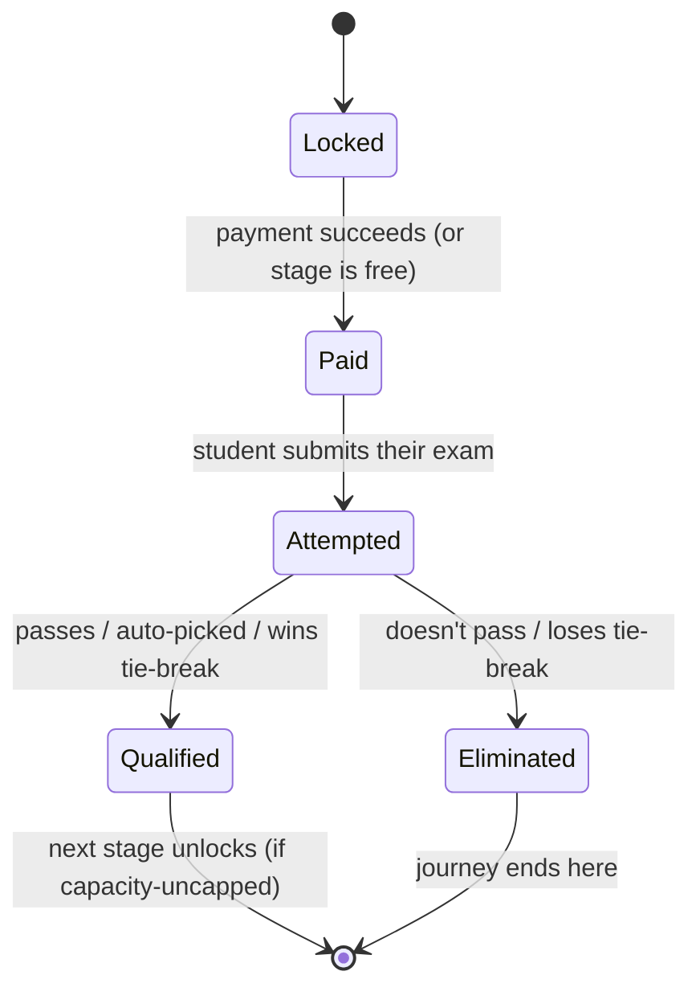
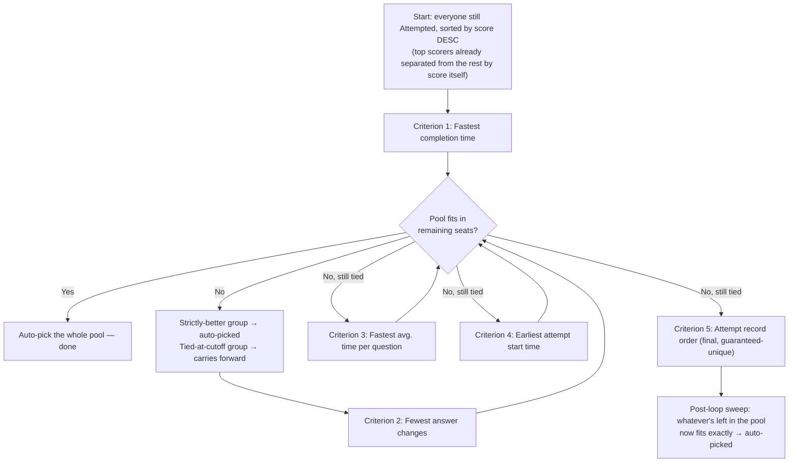
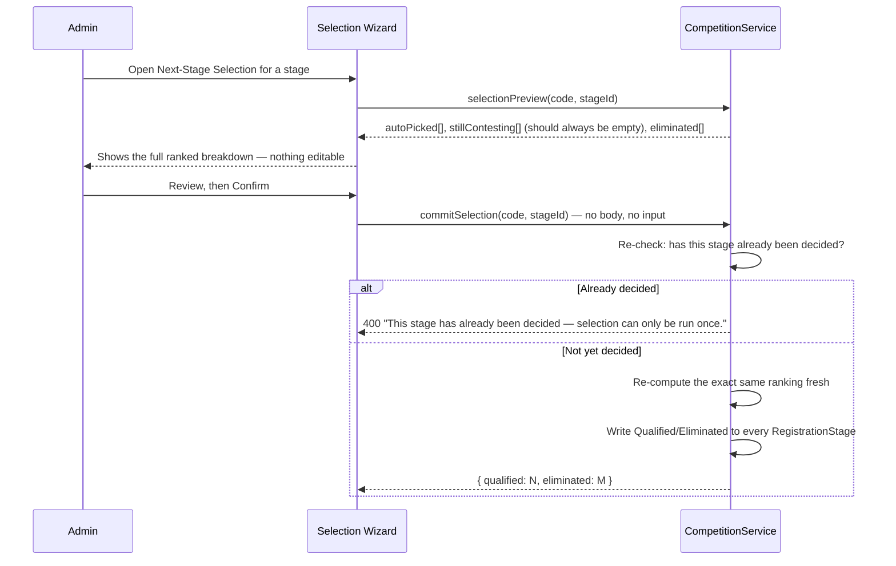

# Results & Selections — Deep Technical Specification

**Module:** Admin → Results (`res`) + Next-Stage Selection wizard
**Audience:** Admins operating the platform day-to-day, and engineers picking up this module.

> This is the most operationally sensitive module in the system: it decides, by algorithm, which students advance and which are eliminated. It was deliberately redesigned to remove human tie-breaking entirely, on legal advice, to eliminate any possibility of personal favoritism in selection. Read this document fully before running a real selection.

---

## 1. The stage lifecycle

Every `RegistrationStage` (one row per student per competition stage) moves through a strict, one-way status sequence:

- **Locked → Paid**: happens automatically the moment a successful payment is recorded for that stage (or immediately, if the stage `isFree`).
- **Paid → Attempted**: happens the moment the student submits their exam attempt for that stage.
- **Attempted → Qualified/Eliminated**: happens **immediately and automatically** if the stage has no `maxQualifiers` cap (uncapped stages just check `percent >= passMark`). If the stage **is** capacity-limited (a real cap on how many can advance), the status stays `Attempted` — genuinely undecided — until an admin runs the **Next-Stage Selection** process described below.

---

## 2. Why manual tie-breaking was removed

Legal guidance was explicit: with a real seat cap and multiple students tied on every objective measure, having a human admin pick who wins the tie creates a personal-favoritism risk — the appearance of it is a real institutional liability even if every actual decision were made in good faith. The fix was to make the *system* the sole decision-maker, deterministically, with no admin-editable input anywhere in the final decision.

**The concrete result:** `commitSelection()` takes no input beyond which stage to decide — no list of "who I'm choosing," nothing a request could tamper with even in principle. The server always (re-)computes its own ranking and applies exactly that.

---

## 3. The cascading-cutoff selection algorithm

When a stage has more `Attempted` students than seats (`maxQualifiers`), the system ranks the entire tied pool through a fixed sequence of five criteria, applied **one at a time**, each one only breaking ties left over from the one before it:

**The five criteria, in order, and why each exists:**

1. **Fastest completion time** — the most meaningful real tie-break; a genuinely faster, equally-correct attempt is a reasonable first differentiator.
2. **Fewest answer changes** — a second, independent signal of decisiveness/confidence.
3. **Fastest average time per question** — a finer-grained version of #1 for anyone still tied.
4. **Earliest attempt start time** — who started first, among students still indistinguishable on every performance metric.
5. **Attempt record order** — a database-internal, guaranteed-unique tiebreaker of absolute last resort. In practice, this criterion is what actually resolves things, because it can never itself produce a tie — everyone reaching it gets separated.

**At each step**, the remaining tied pool is split into exactly two groups by comparing each student's value to the cutoff value (the value at the boundary of how many seats are left):
- Everyone **strictly better** than the cutoff is auto-picked immediately and permanently — they're the "clear" group, not in contention with anyone.
- Everyone **exactly at** the cutoff value stays together as a genuinely-tied group and carries forward to the *next* criterion.
- Everyone **strictly worse** than the cutoff is dropped for good (eliminated) — they were never going to make it regardless of how the tie itself resolves.

**A subtlety that was found and fixed during development, worth understanding:** the in-loop logic only auto-picks the "clear/strictly-better" group *before* each criterion runs — it never, on its own, picks the group sitting exactly at the cutoff. That's correct while a real tie is still open (you can't declare a winner from an unresolved tie), but it's wrong once the final criterion (#5, the guaranteed-unique one) has run — at that point, "exactly at the cutoff" describes precisely one person, the actual winner, and they still need to be picked. A **post-loop sweep** exists specifically for this: once the criteria loop ends, if whatever's left in the pool exactly fits the remaining seats, it's auto-picked. This was verified against real production data before being trusted — a real tied pair was run through the algorithm, confirmed the winning candidate was correctly auto-picked, and confirmed a second run against the same stage was correctly refused (see §4).

---

## 4. Running a real selection — the admin workflow

**The wizard has three steps: qualifiers → criteria → confirm.** There is no manual-selection step — it was removed entirely, along with every piece of UI that used to let an admin check individual students. The wizard is now purely a *review-and-confirm* screen over a decision the server has already made deterministically; nothing in it is admin-editable.

**It can only be run once, ever, per stage** — the very first thing `commitSelection()` does is check whether any `RegistrationStage` for this stage already shows `Qualified` or `Eliminated`. If so, it refuses outright with a clear error. This is the hard guarantee that a result, once committed, can never be silently re-run or changed — not by accident, not by re-clicking, not by anyone.

**`stillContesting` should always be empty in the response.** If you ever see it non-empty, that's the signal something upstream is wrong (e.g. a genuine tie surviving all five criteria, which should be structurally impossible given criterion #5's uniqueness guarantee) — treat that as a bug to investigate before committing, not something to push through.

---

## 5. What "commit" actually writes

For every registration in the pool:
- Everyone in `autoPicked` (and, since `stillContesting` should be empty, that's everyone who was in contention) → `RegistrationStage.status = 'Qualified'`.
- Everyone in `eliminated` → `RegistrationStage.status = 'Eliminated'`.

If the *next* stage has no capacity cap and isn't free-gated behind payment, qualifying students get that next stage auto-unlocked (`Locked → Paid`, skipping the payment step since it's the qualification itself that grants access, not money). If the next stage does have a fee, qualifying just moves them to where they're eligible to pay — payment still has to happen separately.

---

## 6. Troubleshooting & sanity checks

| Symptom | What it means |
|---|---|
| "This stage has already been decided" when trying to commit | Working as designed — someone already ran this selection. Check the Results page for the existing outcome rather than trying to force a re-run. |
| `stillContesting` is non-empty in the preview | Should be structurally impossible (criterion 5 is unique) — investigate before committing; don't proceed. |
| A student who scored lower than someone eliminated is shown as Qualified | Check whether they were separated by score itself (the initial sort) vs. one of the five tie-break criteria — a lower raw score can still rank ahead if they weren't actually tied with the higher scorer on the metric being compared at that point (rare, but not a bug if the criteria genuinely separated them earlier). |
| Selection preview looks right but you're unsure whether to commit | Preview is **read-only** — it never writes anything, no matter how many times you open it. It's completely safe to review repeatedly before committing. |

---

## 7. Key files (for engineers)

| Concern | File |
|---|---|
| RegistrationStage status lifecycle | `api/prisma/schema.prisma` — `RegistrationStage` |
| The cascading-cutoff algorithm | `api/src/admin/competitions/competitions.service.ts` — `selectionPreview()`, `CRITERIA` array |
| The one-time commit + guard | `api/src/admin/competitions/competitions.service.ts` — `commitSelection()` |
| Admin selection wizard (qualifiers → criteria → confirm) | `web/src/app/features/admin/admin-selection-wizard.page.ts` |
| Results page | `web/src/app/features/admin/` — Results module (`res`) |
| Auto-qualification for uncapped stages | `api/src/student/student.service.ts` — `submitExam()` |
