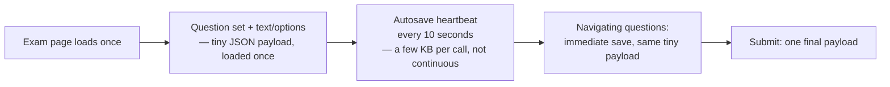
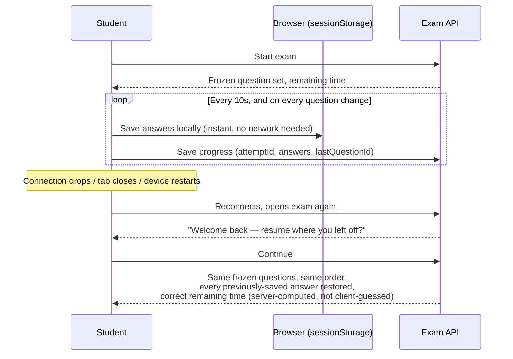

# User Device & Bandwidth — Compatibility & Technical Specification

**Audience:** Admins/stakeholders who need to explain device/network readiness to schools and parents, and engineers maintaining that compatibility.

> The numbers in this document are the same ones published to students on the live **[System Requirements](https://indiamindleague.com/system-requirements)** page — this document exists to explain the engineering *behind* those numbers, not to introduce different ones.

---

## 1. The headline numbers (as published to students)

| | Minimum | Recommended |
|---|---|---|
| **Download speed** | 2 Mbps | 5 Mbps or higher |
| **Connection type** | Stable mobile data (4G/5G) or broadband | Wired broadband, or Wi-Fi close to the router |
| **Device** | Smartphone, 5" or larger | Laptop or desktop |
| **OS** | Android 9, iOS 14, Windows 10, macOS 12 — or newer | Latest available update |
| **Browser** | Chrome/Edge/Firefox 100+, Safari 15+ | Latest version |

**The published guidance leads with stability over speed** — "a steady 2 Mbps beats a fast connection that keeps dropping" — because of how the exam is actually engineered underneath, explained below.

---

## 2. Why 2 Mbps is genuinely enough for an MCQ exam

This isn't an arbitrary floor — it reflects what actually moves over the wire during an attempt:

- **A question is text and multiple-choice options** in the overwhelmingly common case — a JSON payload of at most a few kilobytes, not a media stream. (An `image`/`video`-type question does add real payload weight — see §4.)
- **The exam does not poll or stream continuously.** Progress is saved on a **10-second heartbeat**, immediately on navigating to a new question, and once more on page close — not a constant open connection. Between those save calls, a slow or momentarily saturated connection has nothing it needs to keep up with.
- **The whole question set for the attempt is fetched once**, at the start, not re-fetched per question. A student who loses connection mid-question can usually keep reading and answering from what's already loaded locally, with nothing further to download until the next save fires.

This is why the guidance to students is "stable over fast" — a connection that holds a steady 2 Mbps without dropping serves this traffic pattern comfortably; a much faster connection that disconnects every few minutes is worse for an exam, because reconnecting (not raw throughput) is where real problems come from.

---

## 3. What happens when a connection actually drops — the resume mechanism

This is the engineering that makes the "stable over fast" claim true, not just a hopeful suggestion to students:

- **Progress is saved in two places at once** — the browser's own `sessionStorage` (survives a same-tab refresh with zero network round-trip) and the server (survives a full disconnect, device restart, or switching devices entirely).
- **The question set and order are frozen at attempt start**, not re-randomized on resume — a student picks up the *exact* exam they started, never a different shuffle.
- **Remaining time is always computed server-side** from when the attempt actually started, never trusted from the client — so a student can't gain (or lose) time by how long they were disconnected being miscalculated locally.
- **A final best-effort save fires on page close** (`beforeunload`), using a `keepalive` request so it has the best chance of completing even as the tab is actually closing — not a fire-and-hope, but the most reliable browser mechanism available for "save this even though the page is going away right now."

**The practical result for schools:** a student's exam is not at risk of being lost or corrupted by a Wi-Fi blip, a phone call interrupting mobile data, or a laptop battery dying mid-question — they sign back in and continue from within seconds of where they were, with everything intact.

---

## 4. Where bandwidth demand genuinely goes up

Two cases where the "2 Mbps is enough" guidance has real limits, worth knowing so a school can plan accordingly:

- **Image or video question types** add real payload weight beyond the baseline text/MCQ traffic — a competition that uses these should communicate a higher recommended bandwidth to its students than the platform-wide minimum, since those questions are genuinely heavier than the norm this document is built around.
- **Live/proctored formats** (if used for a given stage) have different, higher continuous-bandwidth needs than the async MCQ pattern described above — this document's numbers assume the standard timed-MCQ format, not a live video component.

---

## 5. Device & browser support — why these specific floors

- **Android 9 / iOS 14 / Windows 10 / macOS 12** and **Chrome/Edge/Firefox 100+ / Safari 15+** were chosen as the floor that still covers the vast majority of real school-issued and family devices in active use, while staying on modern-enough browser engines to support the app's actual UI (Angular's own baseline browser support, standard modern CSS/JS features) without needing legacy fallback code paths that would otherwise add complexity and risk.
- **Internet Explorer is explicitly unsupported** — it cannot run a modern Angular application at all.
- **A 5" smartphone is the minimum, not the target** — the platform is responsive down to phone width, but a larger screen (tablet, laptop, desktop) is recommended specifically because reading and navigating multiple-choice questions comfortably benefits from more screen real estate; a phone is fully functional, just not the *ideal* experience for sustained reading.

---

## 6. What this means operationally for admins

| Scenario | What to tell a school/parent |
|---|---|
| "Our school only has patchy mobile data" | 2 Mbps stable is genuinely enough for a standard MCQ exam — the autosave design means it doesn't need to be fast, just not constantly dropping. A wired connection or Wi-Fi close to the router, if available, is still the recommended fallback. |
| "What if the connection drops mid-exam?" | The exam resumes exactly where the student left off, with correct remaining time — this is a built-in mechanism, not a manual recovery process. Point them to the **[System Requirements](https://indiamindleague.com/system-requirements)** page's "If Something Goes Wrong" section, and the Help Desk contact for anything that needs admin attention. |
| "Can students use their phones?" | Yes, a 5"+ smartphone on a modern OS/browser is fully supported — a laptop/desktop is only *recommended* for comfort, not required for the platform to work. |
| "This competition has image/video questions — is 2 Mbps still enough?" | Communicate a higher recommended bandwidth for that specific competition — the platform-wide minimum is calibrated for standard text/MCQ traffic, not media-heavy question types. |

---

## 7. Key files (for engineers)

| Concern | File |
|---|---|
| Published requirements page (source of truth for the numbers) | `web/src/app/features/public/legal/system-requirements.page.ts` |
| Autosave heartbeat, resume prompt, beforeunload save | `web/src/app/features/account/exam/account-exam.page.ts` |
| Server-side progress save endpoint | `api/src/student/student.controller.ts` / `student.service.ts` — `saveProgress()` |
| Frozen question set + server-computed remaining time on resume | `api/src/student/student.service.ts` — `startExam()` |
